# API Python para demonstrar DevOps

Repositório didático para apresentar, em uma única aplicação, três ideias que se conectam:

1. uma API HTTP escrita em Python;
2. integração contínua com GitHub Actions;
3. execução reproduzível com Docker.

O projeto utiliza FastAPI, pytest, Ruff, GitHub Actions e Docker. Os dados ficam em memória para manter a atenção da aula no fluxo DevOps, sem introduzir banco de dados.

## O que os estudantes devem observar

- O código funciona localmente e no runner do GitHub.
- A mesma suíte de testes é executada pelo desenvolvedor e pelo pipeline.
- O Dockerfile descreve o ambiente necessário para executar a API.
- O pipeline só testa o container depois que qualidade e testes foram aprovados.
- Logs, cobertura e relatórios funcionam como evidências, não apenas como mensagens coloridas.

## Estrutura do repositório

```text
.
├── .github/workflows/
│   ├── ci.yml                 # pipeline de integração contínua (Pull Requests)
│   └── deploy.yml             # pipeline de entrega contínua (ECR + EC2)
├── app/
│   ├── __init__.py
│   └── main.py                # API FastAPI
├── docs/
│   ├── API.md
│   ├── DOCKER.md
│   ├── GITHUB-ACTIONS.md
│   └── ROTEIRO-AULA.md
├── tests/test_api.py          # testes automatizados
├── .dockerignore
├── .python-version
├── compose.yaml
├── Dockerfile
├── pyproject.toml             # configuração de pytest, cobertura e Ruff
├── requirements.txt           # dependências de execução
└── requirements-dev.txt       # dependências de desenvolvimento e CI
```

## 1. Executar localmente

Pré-requisitos: Git e Python 3.13.

### Linux e macOS

```bash
python3 -m venv .venv
source .venv/bin/activate
python -m pip install --requirement requirements-dev.txt
uvicorn app.main:app --reload
```

### Windows PowerShell

```powershell
py -3.13 -m venv .venv
.venv\Scripts\Activate.ps1
python -m pip install --requirement requirements-dev.txt
uvicorn app.main:app --reload
```

Acesse:

- API: <http://localhost:8000>
- documentação Swagger: <http://localhost:8000/docs>
- verificação de saúde: <http://localhost:8000/health>

## 2. Experimentar a API

```bash
curl http://localhost:8000/health

curl -X POST http://localhost:8000/tasks \
  -H "Content-Type: application/json" \
  -d '{"title":"Estudar integração contínua"}'

curl http://localhost:8000/tasks

curl -X PATCH http://localhost:8000/tasks/1/done
```

Endpoints:

| Método | Caminho | Objetivo | Resposta esperada |
|---|---|---|---|
| GET | `/` | Apresentar a API | `200` |
| GET | `/health` | Informar saúde e versão | `200` |
| GET | `/tasks` | Listar tarefas | `200` |
| POST | `/tasks` | Criar uma tarefa | `201` |
| PATCH | `/tasks/{id}/done` | Concluir uma tarefa | `200` ou `404` |

Veja a explicação do código em [docs/API.md](docs/API.md).

## 3. Executar as verificações locais

```bash
ruff check .
ruff format --check .
pytest --cov=app --cov-report=term-missing
```

Esses comandos são deliberadamente iguais aos usados no GitHub Actions. Se uma verificação falhar localmente, ela também deverá falhar no pipeline.

Para aplicar a formatação automaticamente:

```bash
ruff format .
```

## 4. Publicar no GitHub e acionar a CI

O diretório já é inicializado como repositório Git local. Crie um repositório vazio no GitHub e execute:

```bash
git remote add origin https://github.com/SEU-USUARIO/devops-python-api.git
git push -u origin main
```

O arquivo `.github/workflows/ci.yml` dispara o pipeline em três situações:

- `push` na branch `main`;
- `pull_request` destinado à `main`;
- execução manual pela aba **Actions**.

Na aba **Actions**, abra a execução e faça a leitura nesta ordem:

1. workflow;
2. job;
3. primeiro step que falhou;
4. comando e mensagem que explicam a falha.

A explicação detalhada do YAML está em [docs/GITHUB-ACTIONS.md](docs/GITHUB-ACTIONS.md).

## 5. Executar com Docker

```bash
docker build -t devops-python-api:v1 .
docker run --rm -p 8000:8000 --name devops-python-api devops-python-api:v1
```

Em outro terminal:

```bash
curl http://localhost:8000/health
docker ps
docker logs devops-python-api
```

Com Docker Compose:

```bash
docker compose up --build
docker compose down
```

Veja a leitura detalhada do Dockerfile em [docs/DOCKER.md](docs/DOCKER.md).

## 6. Entrega contínua: GitHub Actions, Amazon ECR e EC2

### Arquitetura de implantação

```text
Desenvolvedor ──► Pull Request ──► CI (ci.yml): ruff + pytest + teste do container
                                      │ merge na main
                                      ▼
                         deploy.yml (GitHub Actions)
                 testes ─► build Docker ─► push no Amazon ECR (tag = SHA do commit)
                                      │
                                      ▼ SSH
                  EC2 (Amazon Linux + Docker, IAM Role com leitura do ECR)
              login no ECR ─► docker pull ─► substitui o contêiner ─► verifica /health
```

### Pipeline de integração contínua (`ci.yml`)

Executada em `pull_request` para a `main`: baixa o código, configura o Python, instala as dependências, roda `ruff` e `pytest` (com cobertura) e, se tudo passar, constrói a imagem e testa o endpoint `/health` no contêiner. Se os testes falharem, o PR não deve ser integrado.

### Pipeline de entrega contínua (`deploy.yml`)

Executada em `push` na `main` (ou seja, após o merge de um Pull Request). Possui três jobs encadeados com `needs`, então **nenhuma etapa de entrega roda se os testes falharem**:

1. `test`: instala as dependências, roda `ruff` e `pytest`.
2. `build-and-push`: autentica na AWS, faz login no ECR, constrói a imagem e a publica com a tag igual ao SHA do commit (`github.sha`).
3. `deploy`: conecta na EC2 via SSH, autentica o Docker da instância no ECR, baixa a imagem do commit, remove o contêiner anterior, inicia o novo e verifica o `/health`.

Nenhum comando precisa ser executado manualmente na EC2.

### Configuração necessária (sem credenciais no repositório)

Em **Settings → Secrets and variables → Actions**, cadastre:

| Secret | Descrição |
|---|---|
| `AWS_ACCESS_KEY_ID` | Chave de acesso da AWS |
| `AWS_SECRET_ACCESS_KEY` | Chave secreta da AWS |
| `AWS_SESSION_TOKEN` | Token de sessão (necessário no AWS Academy Learner Lab) |
| `EC2_HOST` | IP público ou DNS da instância EC2 |
| `EC2_USER` | Usuário SSH (`ec2-user` no Amazon Linux) |
| `EC2_SSH_KEY` | Conteúdo da chave privada `.pem` usada no par de chaves da EC2 |

Região (`us-east-1`), repositório ECR (`devops-python-api`) e porta (`8000`) ficam na seção `env` do `deploy.yml`.

Recursos da AWS:

- **ECR:** repositório privado `devops-python-api`.
- **EC2:** Amazon Linux 2023 com Docker instalado, perfil de instância IAM (IAM Role) com permissão de leitura no ECR e Security Group liberando a porta 22 (SSH) e a porta 8000 (API).

### URL da API publicada

`http://54.226.107.171:8000` (health check: `http://54.226.107.171:8000/health`)

O endereço corresponde à instância EC2 usada na avaliação e deixa de responder quando os recursos da AWS são encerrados.

> **Nota sobre o endereço IP:** as capturas de tela do primeiro deploy (versão 1.0.0) mostram o IP `3.91.79.99`. Essa é a mesma instância EC2 (`i-043a09568c3db9d6b`). O ambiente AWS Academy Learner Lab interrompe a instância ao encerrar a sessão e, ao religá-la, o IP público muda para `54.226.107.171`, que é o endereço atual e o mostrado nas capturas mais recentes. Nenhuma outra instância foi utilizada, e o contêiner voltou a executar sozinho (`--restart unless-stopped`).

### Como verificar a versão implantada

```bash
curl http://<IP-PUBLICO-DA-EC2>:8000/health
# {"status":"ok","version":"2.0.0"}
```

A versão vem de `version` em `app/main.py`. Para confirmar a imagem em execução, o SHA do commit aparece na tag da imagem no ECR e na saída de `docker ps` na EC2.

### Evidências da execução

Capturas de tela na pasta [docs/evidencias/](docs/evidencias/) e links:

- Pull Request 1 (pipeline CI/CD, versão 1.0.0): <https://github.com/julia12005/devops-python-api/pull/1>
- Pull Request 2 (atualização para a versão 2.0.0): <https://github.com/julia12005/devops-python-api/pull/2>
- Pull Request 3 (documentação e evidências no README): <https://github.com/julia12005/devops-python-api/pull/3>
- Execuções do CI e do deploy (ambas com sucesso): <https://github.com/julia12005/devops-python-api/actions>
- Primeiro deploy (versão 1.0.0): <https://github.com/julia12005/devops-python-api/actions/runs/43338793063>
- Segundo deploy automático (versão 2.0.0): <https://github.com/julia12005/devops-python-api/actions/runs/43343125001>
- Imagens no Amazon ECR: uma tag por commit (SHA), uma para cada versão implantada.
- Contêiner em execução na EC2: `docker ps` e `curl http://localhost:8000/health`, que passou de `"version":"1.0.0"` para `"version":"2.0.0"` sem nenhum comando manual de deploy.

#### Relação entre versões, commits e imagens no ECR

| Versão da API | Commit (tag da imagem no ECR) | Origem |
|---|---|---|
| 1.0.0 | `2d524cbbd6325b19aac31fa85dc3c5c39cfbe943` | Merge do PR 1 |
| 2.0.0 | `5ec4b6e2c0b6e27fe19760f458de76d1d97be8f0` | Merge do PR 2 (segundo deploy automático) |
| 2.0.0 | `9951800f4dbcb57bb6d313c7ae9b6384917215f6` | Merge do PR 3 (apenas documentação) |

#### Integração contínua

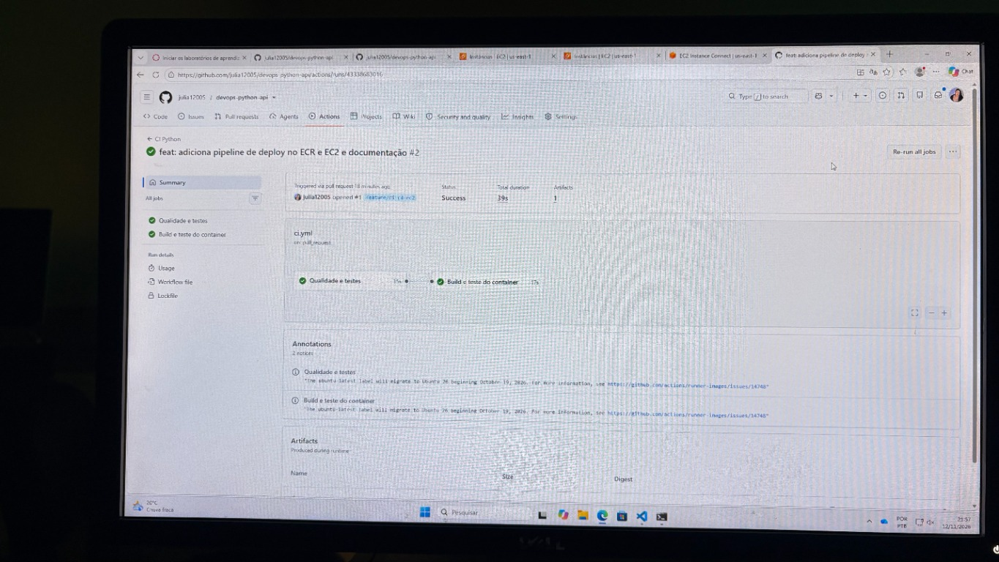
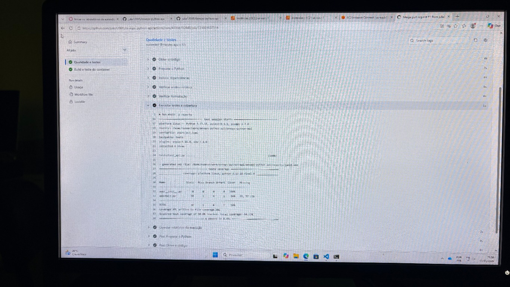
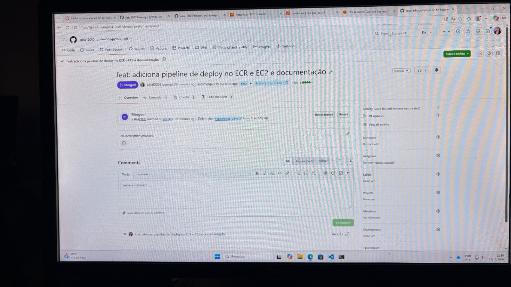

#### Publicação no Amazon ECR

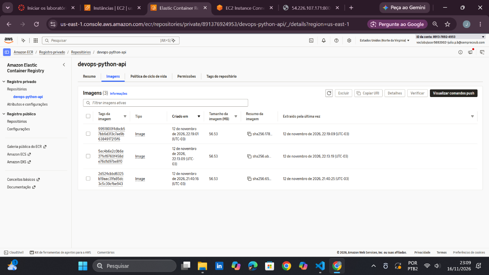

#### Primeiro deploy (versão 1.0.0)

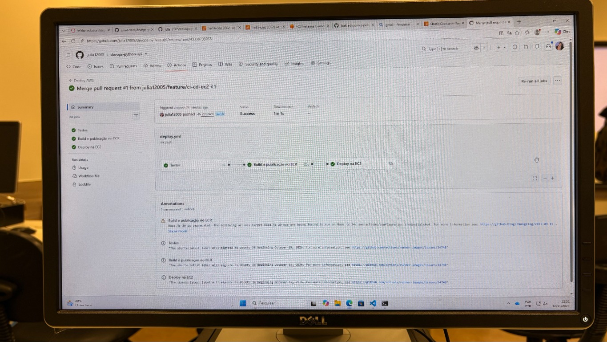
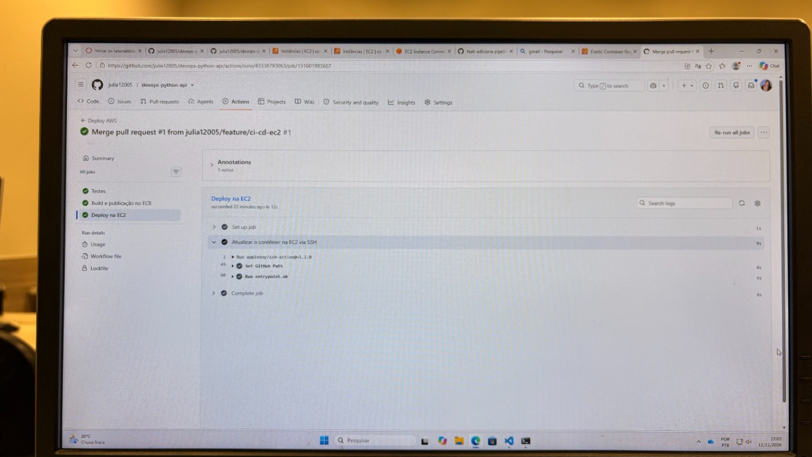
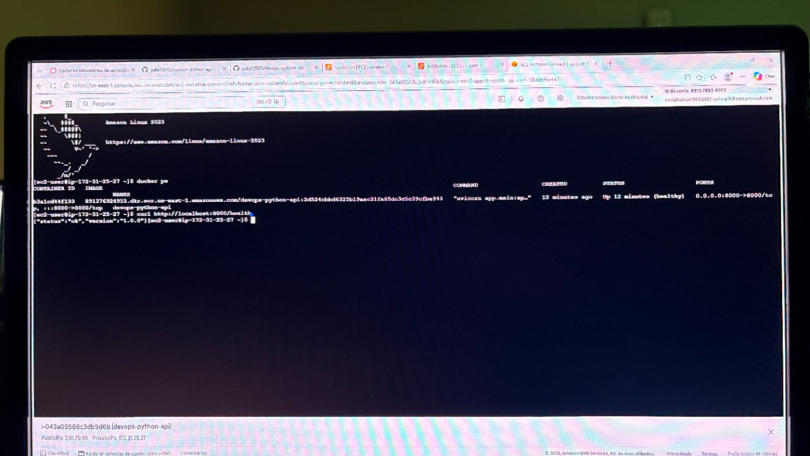

#### Segundo deploy automático (versão 2.0.0)

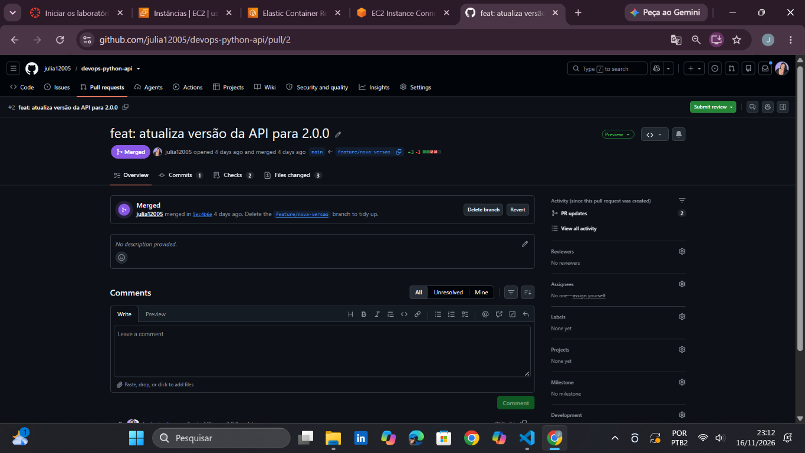
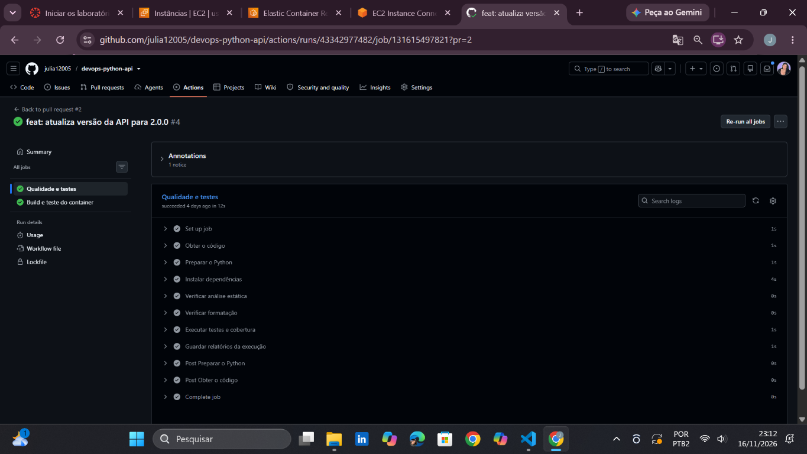
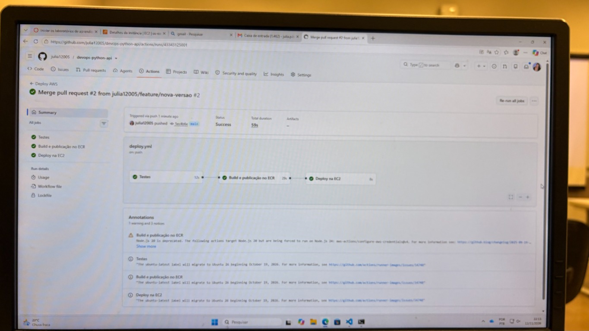
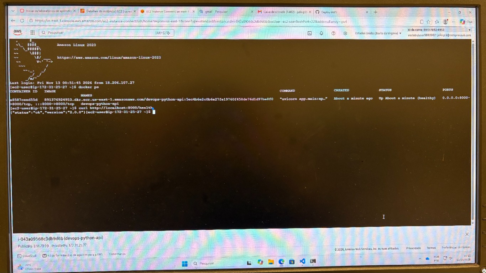
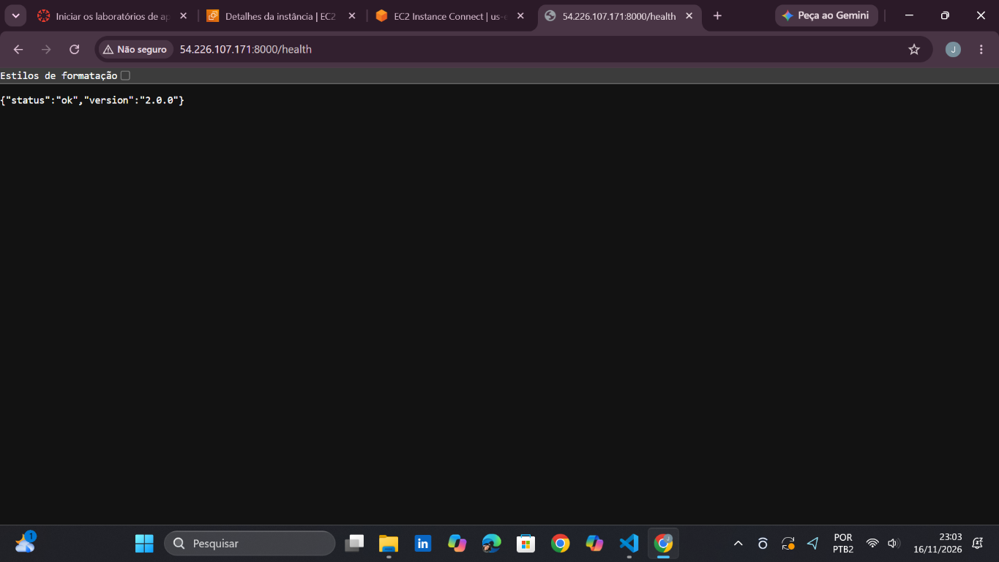

## Falhas intencionais para demonstrar

### Falha de teste

Em `app/main.py`, altere temporariamente a versão do health check para `3.0.0`. O teste espera `2.0.0`, então o pytest e o pipeline devem falhar.

### Falha de qualidade

Adicione um import não utilizado no início de `app/main.py`:

```python
import os
```

O step `ruff check .` localizará o problema.

### Falha de rede no container

No `Dockerfile`, troque `--host 0.0.0.0` por `--host 127.0.0.1`. O processo iniciará, mas o serviço não ficará acessível pela porta publicada no host.

## Próximos desafios

- Adicionar um endpoint `DELETE /tasks/{id}` e seus testes.
- Executar os testes em uma matriz com Python 3.12, 3.13 e 3.14.
- Publicar a imagem em um registry somente após a aprovação dos testes.
- Substituir o armazenamento em memória por um banco de dados.

## Referências oficiais

- [GitHub Actions: criar e testar Python](https://docs.github.com/pt/actions/tutorials/build-and-test-code/building-and-testing-python)
- [actions/checkout](https://github.com/actions/checkout)
- [actions/setup-python](https://github.com/actions/setup-python)
- [actions/upload-artifact](https://github.com/actions/upload-artifact)
- [FastAPI](https://fastapi.tiangolo.com/)
- [Docker para Python](https://docs.docker.com/language/python/)
